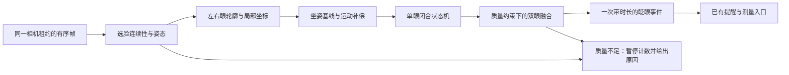

# 侧置摄像头识别增强设计

> 2026-10-22 状态更新：侧置识别、目标锁定和质量门槛已按用户要求撤回；本文识别部分保留为历史设计，不代表当前生产行为。相机终止协调继续保留。见[回归说明](original-recognition-rollback.md)。

2026-10-22。用户新增目标：**摄像头在右侧约15–30°，人自然看屏幕时仍能识别眨眼**。这是在原版复刻之外的增强需求。当前已接入原生相机流程并提供坐姿校准，测试与签名包已构建；人工侧置识别验收尚未通过，以下目标指标不能当作实测结果。

## 当前多人环境增强（v3）

用户无法保证画面只有一人，并要求先离线工作。已在同一相机流程加入保守的前景空间目标跟踪，旁人入镜时继续找原目标，丢失或混淆时暂停；目标重获会清旧眼部校准。测量来源升级为`side-contour-v3` / `spatial-primary-v1`。详见[旁人入镜设计与验收范围](primary-target-design.md)。下文v2检查点作为历史，不代表v3已实机验收。

## 当前实现检查点（可见眼 v2）

- 保留 `CameraFrameRun` / `CameraPipeline` 唯一相机入口、有序队列、generation/FIFO、预读与180秒期限。原版分析可通过关闭“适应侧置摄像头”进入。
- 不再用绝对40°/25°/35°挡住可见眼校准。有限姿态、相对姿态突变、平移/缩放突变、缺帧和轮廓像素门槛仍生效；更大静态角度测试只证明状态机允许尝试，不能证明Vision识别准确。
- 新增“优先使用清晰的一只眼”（默认开启，响应本用户的单眼需求）：首次按可解析眼宽选眼，在同一可见模式内锁定，闭眼或宽度抖动不换眼。关闭时优先双眼，一眼缺失或远眼过小则自动降级；宽度比0.6进入单眼、0.75退出，减少模式跳动。宽度是可解析性线索，不是经过标定的遮挡置信度。
- 双眼模式仍要求双眼闭合/重开；单眼模式只判断所选眼的闭合/重开，不能区分单眼眨动与双眼同时眨眼，也不能确认隐藏眼状态。无可解析眼不计数。换眼会清除半次候选并使用独立校准。
- 眼宽至少10像素，稳定0.2秒后收集1秒/至少15帧的睁眼样本。三次校准闭合不计数；闭合阈值单眼<0.55，双眼一眼<0.55且另一眼<0.70；重开≥0.78；候选0.06–0.8秒，缺帧>0.15秒丢弃。参数仍待标注数据评估。
- 姿态缓存先同时过滤yaw/pitch，再按二维距离选取；优先已完成校准的基线，进入12°、已验证当前项退出16°的有限迟滞，避免相邻未完成项、边缘抖动或pitch不匹配项抢占。此规则来自首轮4→8的漏计反馈和真实反复校准日志，已用两项红测复现后修复。
- 数值校准最多缓存5组姿态/可见模式，满时优先淘汰校准闭合较少、其次最久未用的项，避免新姿态挤掉验证结果；仅在内存；设备/分辨率/重新适配/单眼策略切换清校准，租约结束清候选。基线不在闭眼期间更新。
- `side-contour-v2`测量携带可见模式（双眼/左眼/右眼/混合）及有效覆盖率，85%不足则取消。单眼或混合结果在历史/最近一次/悬停明细标为“单眼估计”，橙色点显示，不进入双眼平均频率/时长。旧记录保持不变且可兼容读取。
- UI显示识别方式及yaw/pitch/roll参考，不再因一个未经验证的绝对角度提示用户必须转向摄像头。检测事件继续通过原有Core入口响应训练提醒。
- v1历史检查点N098/N099为164/73测试；N100被绝对角度门槛阻挡。v2首包N102在真实相机完成单眼校准，用户反馈十次动作4→8，明显漏计；N103标为失败。N104/N105修复匹配后，N106用户反馈“可以了”但无定量起止值；N107正式测量因质量不足未入库，进一步修复校准淘汰及窗口迟滞。当前证据另存N108起，不继承此前准确率结论。

v2复现与范围：`experiments/side-camera/check-cache-retention.py`、`evidence/native-tests/visible-eye-retention-integration-check.json`。后文保留原方案和后续人工准出目标；与本段冲突时以本段实现为准。

## 目标与边界

- 首要验收右侧15°、30°；正面作回归，左侧同角度作镜像/左右眼对照。
- 右侧摄像头不等于画面右侧，也不直接决定哪只眼可信。处理原始图像坐标、EXIF方向和预览镜像后，由实际眼区质量判断。
- 45°仅作为探索边界。另一只眼被鼻梁遮住、画面分辨率不足时，不承诺还原不可见信息。
- 全程在Mac本机处理，沿用已有相机权限和唯一相机租约；不保存、上传用户相机帧。新方案仍以arm64/macOS14为基线。

## 当前实现的具体限制

|位置|当前行为|侧置场景的影响|
|---|---|---|
|`CameraEyeTracking.swift`|旧CNN选脸，每4帧用dlib五点精修眼位，其他帧复用|五点包含眼角/鼻点，没有上下眼睑轮廓，也没有姿态、单眼可见性和坐姿校准|
|`EyeGeometry.swift`|按原版公式生成方形眼区和共用归一化量|左右眼透视尺寸不同；倾斜姿态下仍沿用原几何，不能靠调一个阈值解决|
|`CEyeFlow.cpp`|在前帧眼区采样图像竖直方向光流|没有按眼睛自身方向对齐，也未单独去除头部整体运动|
|`OpticalFlowStream.swift`|恢复的双眼候选扫描与旧合并规则|用于复刻，不应直接作为侧置融合规则；降低门槛会同时引入转头/定位抖动误报|
|`CameraFrameRun.swift`|统一预读、帧分析、失败和完成出口|保留作为设备生命周期入口；增强不能另外打开相机或另建测量计时器|

根本需要区分：眼睑真实闭合、头部运动、定位丢失。仅让人脸检测更容易通过，并不等于能正确判断眨眼。

## 算法方案

使用macOS已有的Vision：先显式运行`VNDetectFaceRectanglesRequest` revision3，再把当帧observations传入`VNDetectFaceLandmarksRequest` revision3/76点，取得眼睑轮廓和可用的yaw/roll/pitch。仅设置landmarks revision3时，本机实际仍走旧默认选脸路径、pitch为空，因此不能省略姿态请求。沿用旧版检测作为对照，不将原版组件精确一致的证据迁移为增强版的准确率证明。

### 1. 按眼睛自身坐标测量

- 把眼轮廓从face boundingBox归一化坐标转换为图像像素，再按眼角连线建立局部横纵轴。不能直接比较归一化坐标中的x/y距离：图像和脸框宽高不同会产生比例误差。
- 用眼睑在局部纵轴的开合幅度、局部眼宽和面积构造开合特征；具体点索引须由固定请求版本的实际轮廓验证，不猜测“第几个点是眼角”。
- roll只做平面方向对齐；yaw导致的透视变化依靠分眼/分姿态基线处理。不能把2D拉伸、除以cos(yaw)当成恢复隐藏眼睛。
- 保留逐帧时间戳，使用经过时间而不是固定帧数，覆盖掉帧和设备帧率变化。

### 2. 按实际坐姿校准左右眼

- 校准时继续自然看常用屏幕，不要求先正对摄像头。
- 初版提供约10–15秒引导：短暂保持自然睁眼，再自然眨眼3次。此时长是交互预算，质量不足不能到时强制成功。
- 分别建立左右眼的睁眼基线、闭合样本和噪声范围，按头部姿态小范围分组。不能共用一个固定绝对开合阈值，也不能固定“靠摄像头的眼睛一定有效”。
- 正常运行只用稳定睁眼、高质量样本缓慢更新基线；闭眼、遮挡、转头时冻结。基线不可在长时间闭眼后把闭眼学成睁眼。
- 姿态明显改变、设备/分辨率切换、追踪对象改变时重新建立对应基线。初版只在内存缓存，不保存人脸图像、身份特征或校准视频。

### 3. 抑制转头和平移

- 用鼻梁、眼角等相对稳定点估计帧间相似变换，得到整体平移/旋转/尺度变化；局部运动特征减去整体运动。
- 不把正在闭合的上下眼睑用于估计整体运动，否则会把真实眨眼一并抵消。
- 大幅姿态跳变、脸切换、图像边缘截断或时间间隔过大时，取消当前半次候选，稳定重获后从已确认睁眼开始。不能把“丢失前闭眼”和“恢复后睁眼”拼成一次眨眼。

### 4. 分眼质量与时序融合

- 每眼状态：未校准 → 稳定睁眼 → 闭合候选 → 已闭合 → 重新睁眼 → 输出一次事件。闭合/重新睁眼采用不同阈值，设置时间范围和防重复间隔；参数须由标注样本确定。
- 两眼都可靠时，检查闭合/重开时间一致性，融合为一次事件，而非左右各记一次。
- 远眼仍有可用轮廓但质量较低时降低其融合权重，要求其提供方向一致的弱证据。
- 一眼完全不可见时，v2允许可见眼独立校准和闭合计数，结果明确作为“单眼估计”；遮挡缺失不是闭眼，不可把单眼结果宣称为“双眼眨眼”。
- 质量依据包括眼角/轮廓连续性、边界截断、像素宽度、相对姿态和可选的点位置精度估计。**眼睛变窄本身不是低质量条件**，否则闭眼时会被误当作遮挡而永久漏检。
- Vision的pose、轮廓和精度字段都可能缺失。缺失不能当作0°或100%可见；`faceCaptureQuality`也不是眨眼置信度，不能因为闭眼让人像质量下降就丢掉真实眨眼。

## 与现有应用衔接

- 保留当前相机仲裁、generation/output身份守卫、有序交付及错误终止逻辑；替换的是帧分析策略，不另建AVCaptureSession或计时链。
- 一次租约启动时固定分析策略，预览/训练/测量共用。更换策略先取消旧候选、停止旧租约，拒绝晚到结果；不要在一次测量中无标记地混用两套计数。
- 原算法继续作开发对照。侧置与单眼优先开关默认开启，仍明确为待实机验收的增强；普通用户界面不暴露CNN/光流/模型版本等实现选项。
- 新增内部样本质量和有效画面时长，不把无效画面等同零次眨眼。拟定有效覆盖率门槛85%，未达标则本次不保存“低频结果”。85%门槛已实现，具体数值仍待标注数据校准。
- 生产测量仍为180秒，不把计数除以短暂有效时长来偷偷改变BPM定义。新增记录带算法版本及质量摘要；旧历史兼容读取，禁止重算或覆盖现有8条记录。
- 初版不承诺单次眨眼时长与旧光流数值逐点相等。轮廓阈值跨越得到的时长须独立标注评估，并记录算法版本，避免误导历史趋势比较。

## 界面设计

摄像头页增加“适配我的坐姿”入口。沿用原生Form/按钮/状态文字：

1. “保持平时看屏幕的姿势”，预览上可选择显示眼区轮廓，左右与镜像保持一致。
2. “自然眨眼3次”，显示完成数，不要求用户记住角度。
3. 完成后显示“当前坐姿识别稳定”；不稳定时明确提示“右眼被遮挡”“眼部画面太小”“转头后正在重新识别”等实际原因。原因必须有相应可观测数据，不凭摄像头方位推断。

日常只显示“识别稳定 / 正在适应坐姿 / 暂时无法可靠计数”。不显示未经校准的准确率百分比，不要求用户始终正对摄像头。

## 实施顺序与准出

|阶段|具体交付|通过条件|
|---|---|---|
|A 技术可行性|冻结公开图像上的Vision原生探针、API可用性、时延与字段缺失检查|arm64/macOS14目标编译；能取得真实眼轮廓/姿态；不访问用户相机和历史。此项不算侧置准确率通过|
|B 分析原型|局部眼坐标、分眼校准、开合状态机、运动补偿、质量门槛|有针对性的旋转/缩放/缺帧/遮挡/重获/镜像测试；增强只走同一有序入口；现有复刻回归保持|
|C 右侧场景验证|右侧0°/15°/30°，左侧对照；自然眨眼与转头/低头/眼镜/光照组合|下面的标注数据准出；没有数据就保留实验状态，不用固定图片或模拟事件代替|
|D 应用验收|校准界面、提醒、完整180秒测量、质量不足不入库、版本化历史、退出/睡眠/重连|实际UI和硬件逐项证据，现有历史/设置保持；验收后再评估默认启用|

候选效果门槛（目标，尚未测得）：

- 在右侧15°/30°的正常室内场景，每个角度分别报告precision/recall，拟定precision≥95%、recall≥90%；不能只汇总一个平均数掩盖30°失效。
- 使用许可允许的、带事件时间标注的独立自然眨眼视频，计划至少5人、每个目标角度至少100次事件；按人划分校准与验收数据。转头、单眼眨动、遮挡和多人分别报告误报。
- 双眼合并的事件匹配窗口、起止定义及样本排除规则先固定再测；闭眼时长误差、有效画面覆盖率、端到端事件延迟同时报告，不能只追求少报来提高precision。
- 本机实际有效分析帧率目标≥20FPS、端到端p95处理预算≤50ms。必须测完整采集/分析/交付及长时间资源占用；单张图片请求耗时不是相机FPS。
- 若逐帧Vision达不到预算，先测输入脸框复用、ROI与请求频率组合。不能简单降到低频轮廓采样后宣称短眨眼仍可完整捕获。
- 用户现场“眨眼10次看计数”用于快速发现问题；没有独立事件标注时，只能报告粗计数差异，不能据此声称precision/recall。默认不录制用户视频；任何另行采集/保存须单独获得授权。

## 技术依据

- [Apple VNFaceObservation](https://developer.apple.com/documentation/vision/vnfaceobservation)：姿态为可选值，不保证每帧都有。
- [Apple VNFaceLandmarks2D](https://developer.apple.com/documentation/vision/vnfacelandmarks2d)：双眼轮廓及脸框局部坐标。
- [Apple face rectangles revision3](https://developer.apple.com/documentation/vision/vndetectfacerectanglesrequestrevision3)：本机SDK确认该版本提供连续的yaw/roll/pitch。
- 本机SDK头文件确认：VNDetectFaceLandmarksRequest revision3/76点和逐点位置精度估计从macOS10.15可用，pitch从macOS12可用。使用既有VN类，避免引入macOS15起的新Swift Vision API。部署目标编译不等于已在macOS14硬件验收。
- 当前可行性实验：`experiments/side-camera/vision-feasibility.swift`。结果见`evidence/native-tests/side-camera-vision-feasibility.json`；只用既有公开裁剪，不是侧脸/自然眨眼效果证明。

## N097离线可行性阶段（接入前）

- 已完成arm64/macOS14目标编译；在既有640×480公开图的4张脸上返回76点、每眼6个轮廓点及对应位置精度估计。隐式请求的4组pitch全部缺失；显式rectangles revision3后4组yaw/roll/pitch均存在。黑图控制组无脸。
- 显式两步请求的本机冷启动约807ms，20次预热后单图请求中位约8.1ms、p95约12.0ms。它不含相机、像素转换、校准、运动补偿和事件融合，不能换算成相机FPS或宣称已满足完整20FPS预算。
- 本轮没有接入正式App、启动相机、访问用户历史或采集用户样本；右侧15–30°效果、自然眨眼准确率和macOS14硬件运行均未验证。
- 验证器与复现步骤见`experiments/side-camera/README.md`；机器可读范围见`evidence/native-tests/side-camera-feasibility-check.json`。下一实现项为阶段B，不把这个可行性检查记为原版功能准出。
